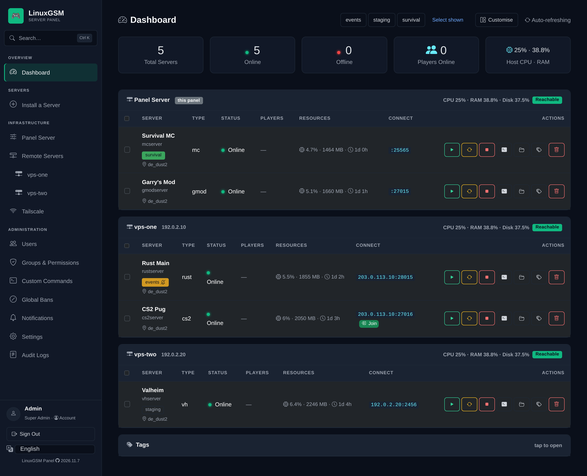
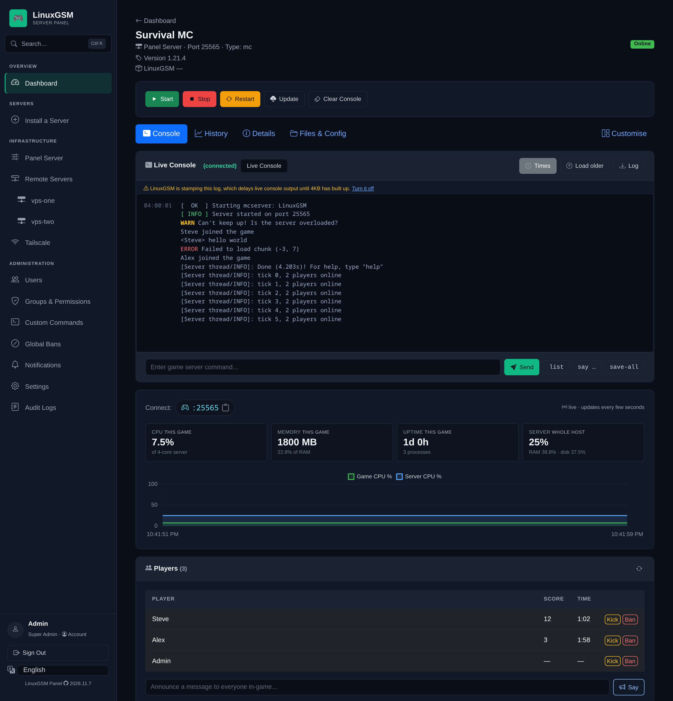
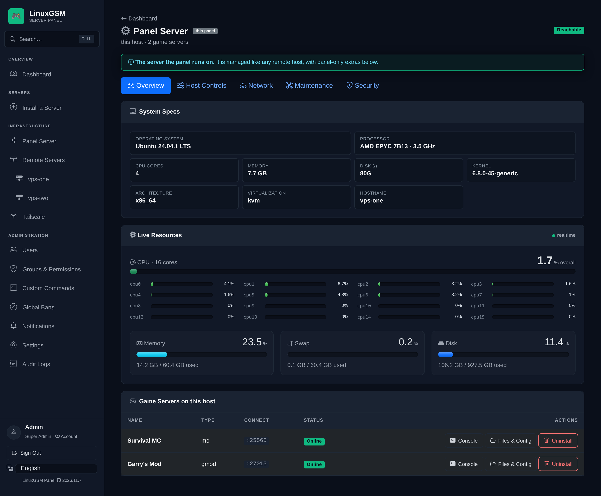
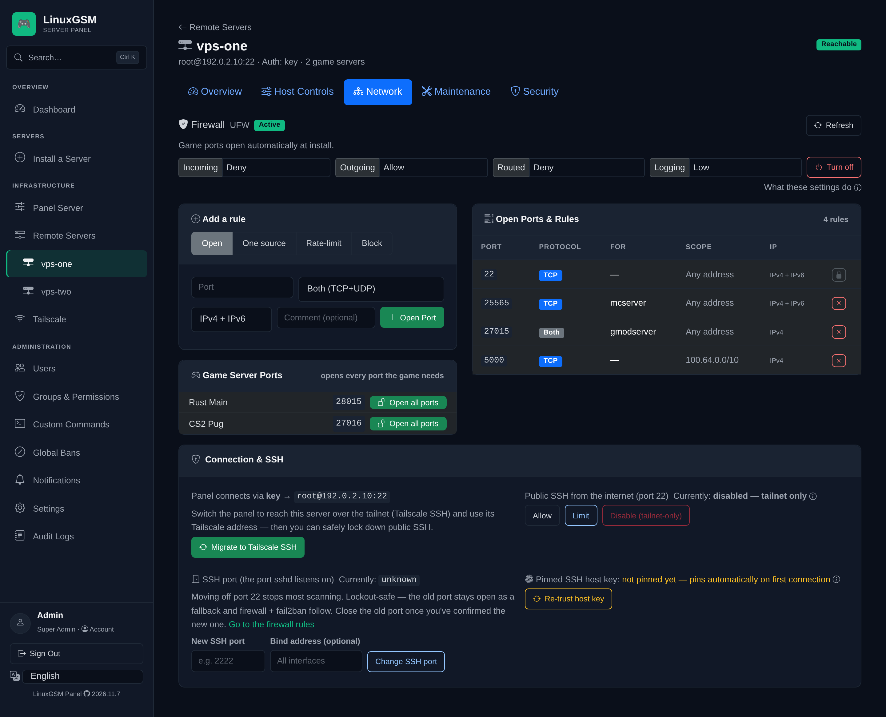
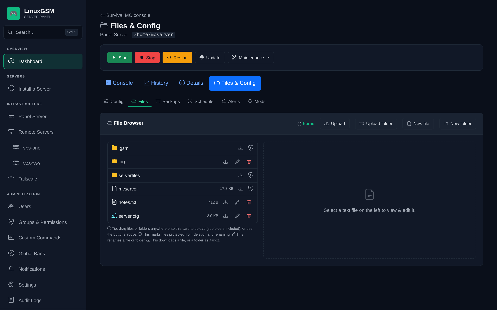
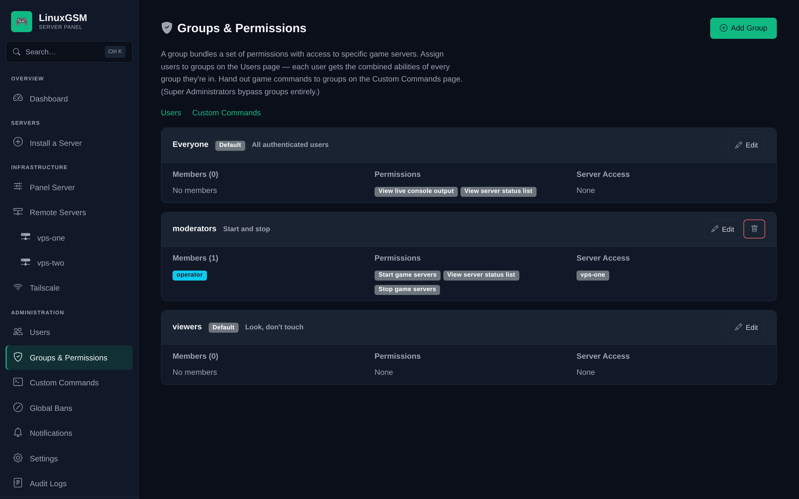
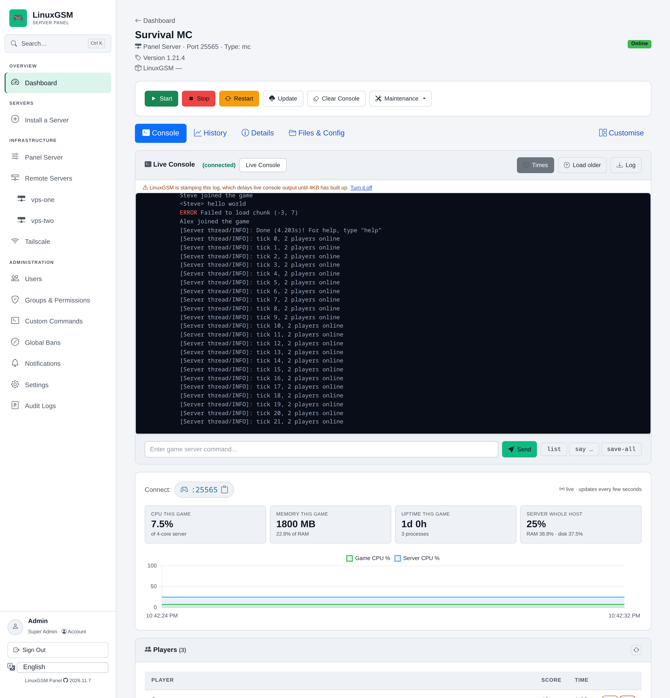
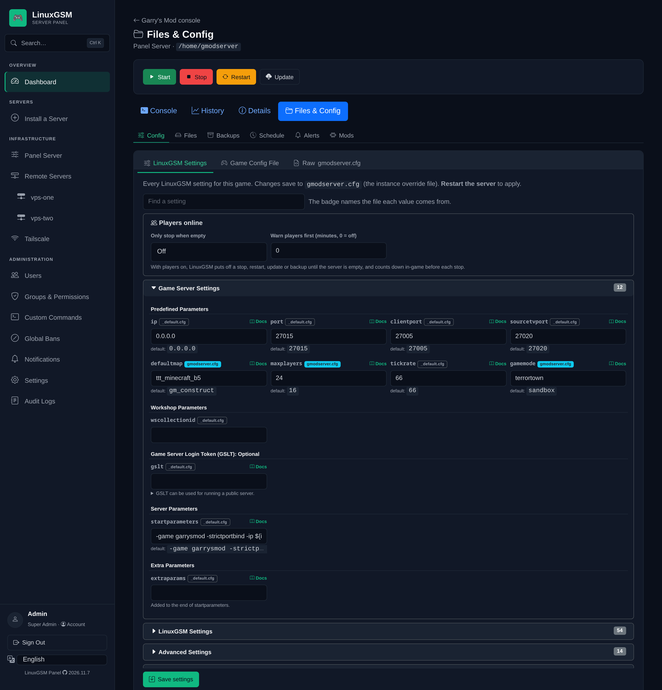
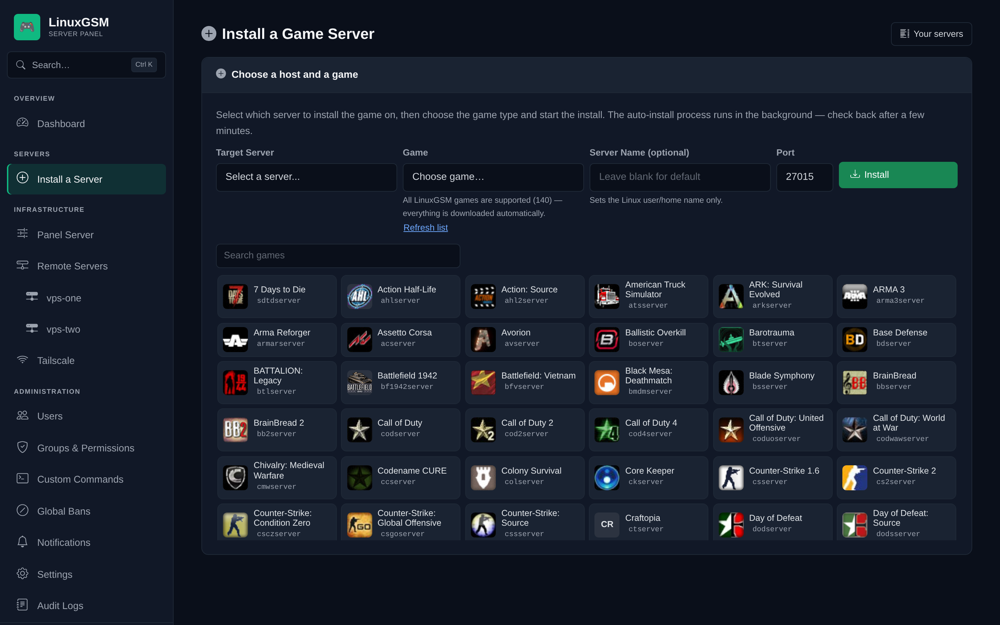
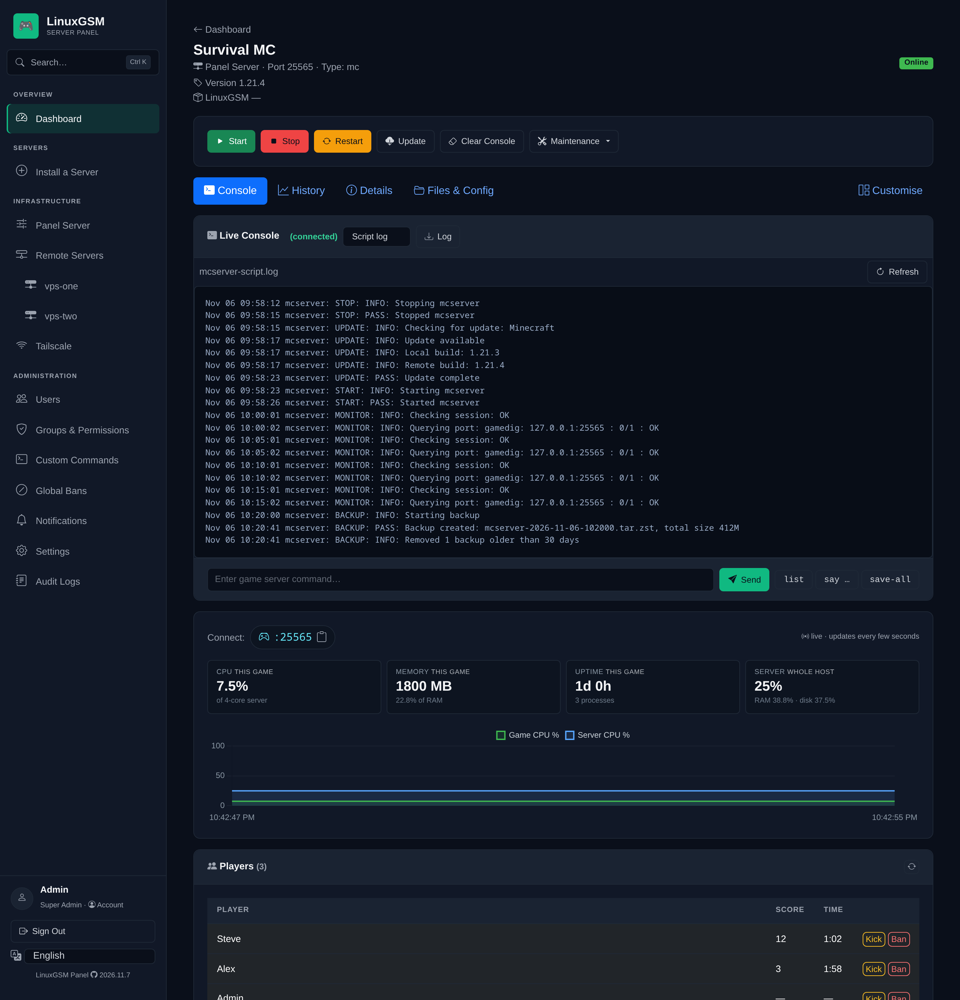

# LinuxGSM Panel 🎮

[](https://scorecard.dev/viewer/?uri=github.com/FMSMITH91/linuxgsm-panel) [](https://www.bestpractices.dev/projects/15363) [](https://app.codacy.com/gh/FMSMITH91/linuxgsm-panel/dashboard?utm_source=gh&utm_medium=referral&utm_content=&utm_campaign=Badge_grade)

[](https://github.com/FMSMITH91/linuxgsm-panel/actions/workflows/ci.yml) [](https://github.com/FMSMITH91/linuxgsm-panel/actions/workflows/codeql.yml) [](https://github.com/FMSMITH91/linuxgsm-panel/actions/workflows/security.yml) [](https://github.com/FMSMITH91/linuxgsm-panel/actions/workflows/security-code.yml) [](https://github.com/FMSMITH91/linuxgsm-panel/actions/workflows/codeql-alerts.yml) [](../LICENSE) [](https://www.python.org)

A self-hosted web panel for managing **[LinuxGSM](https://linuxgsm.com)** game servers across one or more Ubuntu machines, with role-based access for super admins, server admins, and moderators.

📓 [Changelog](CHANGELOG.md) · 🔒 [Security policy](../.github/SECURITY.md) · 🔐 [HTTPS setup](https.md)

> ## ⚠️ Disclaimer — please read first
>
> - **Not an official LinuxGSM product** — an independent third-party panel, not affiliated with, endorsed by, or connected to LinuxGSM or its authors. "LinuxGSM" and any related marks belong to their respective owners.
> - **Created and modified almost entirely by AI.** Read the code and test it before trusting it with real servers or credentials.
> - **Provided "as is", no warranty — use at your own risk.** See [Security](#security).

## Requirements

- A host running **Ubuntu 22.04, 24.04 or 26.04 LTS** for the panel (CI tests all three, each on the Python that release ships — 3.10, 3.12 and 3.14; other distros may work but aren't supported).
- One or more game-server machines, reachable over SSH (key, password, or Tailscale SSH). The panel host can also manage itself.
- **LinuxGSM** on those machines, or let the panel install it.
- *Optional:* **[Tailscale](https://tailscale.com)** for private HTTPS with no open ports.

## Quick install

```bash
curl -fsSL https://raw.githubusercontent.com/FMSMITH91/linuxgsm-panel/main/install.sh | bash
```

The installer runs unattended. It:

1. Installs its prerequisites and patches the OS with `apt full-upgrade` (skip with `PANEL_NO_UPGRADE=1`). If the upgrade needs a reboot it reboots at the end, unless game servers are running; `PANEL_NO_REBOOT=1` skips the reboot.
2. Clones the repo, builds a Python virtualenv, picks a free port (5000 by default) and serves HTTPS with a self-signed certificate.
3. Sets up the service, **never running the panel as root**:
   - **As a normal user** → a `systemd --user` service with linger, so it survives logout and reboot.
   - **As root** → a dedicated non-login **`lgsmpanel`** user running a system service, with a scoped passwordless-sudo entry for managing the local host (see [SECURITY.md](../.github/SECURITY.md)).
   - Either way, the `linuxgsm-panel-recover` command (reset a password, turn off 2FA, create an admin from a shell).
4. Asks whether to turn on **Tailscale SSH on the panel host** (no by default). Answer ahead with `PANEL_TAILSCALE_SSH=1` or `=0`, placed after `sudo`: `curl … | sudo PANEL_TAILSCALE_SSH=1 bash`. An update keeps the answer.

In a terminal on the panel host, `sudo` to root is refused (the panel user's grant names only its helper and the game accounts). To allow it, re-run the installer with `PANEL_TERMINAL_SUDO=1` and give the panel user a password (`sudo passwd lgsmpanel`); sudo then asks for it every time, and `PANEL_TERMINAL_SUDO=0` removes it. You would be typing that password into a terminal the panel renders, so it protects against a stolen session, not a compromised panel.

Then open **the link the installer prints at the end** — `https://your-server:5000/setup?token=…` (`http://` won't load) — accept the one-time certificate warning (**Advanced → Proceed**), and the **setup wizard** creates your first super admin. The token makes the install yours: until the first admin exists, only a browser that has shown it can use the wizard. Lost the link? `sudo linuxgsm-panel-recover setup-token` prints it again.

### Updating

- **In the panel:** *Panel Server → Update* (or the Telegram/Discord `/update` command). It moves only to a commit whose CI checks all passed, and survives its own restart.
- **From the shell:** run the installer already on the host: `cd / && sudo bash /usr/local/lib/linuxgsm-panel/install.sh` (root install) or `bash ~/linuxgsm-panel/install.sh` (per-user). This takes the branch tip directly, without the CI gate (or first a release it may not skip, below).

Either way the updater snapshots the code and database (keeping the last 3), installs dependencies only when they changed, restarts the panel and health-checks it. If the panel does not come back it **rolls back the code and database automatically**. On a root install it also refreshes the root-owned pieces in `/usr/local/lib/linuxgsm-panel`.

**Only signed releases are installed.** The installer already on the host moves the panel only to a commit signed with the project's release SSH key, which is kept off GitHub. Anything else is held with "Not updated: held at …" and the reason. The host checks against its own copy of the public key (`release-signers`), never the copy inside the update. Installing with `curl … | bash` runs the installer from GitHub, so it is not covered by the signature: use it only for a first install, which has no key to check against yet; see [SECURITY.md](../.github/SECURITY.md) for what to check after the first update. If a host says it has no release key, run the installer by hand once over SSH with `PANEL_ALLOW_UNSIGNED_UPDATE=1`: `cd / && sudo PANEL_ALLOW_UNSIGNED_UPDATE=1 bash /usr/local/lib/linuxgsm-panel/install.sh` (root install) or `PANEL_ALLOW_UNSIGNED_UPDATE=1 bash ~/linuxgsm-panel/install.sh` (per-user).

**Versions are dates**: the date of the commit, in UTC, shown with the short commit (`2026.9.26 · a1b2c3d` in the footer).

**Some releases cannot be skipped.** A release that the next one depends on (one that teaches the updater something) is listed in `panel/install/update-stops`. A panel further behind installs that release first, and the newest one on its next update: the Update card simply offers an update again.

**If updates keep rolling back to the same version:** the panel's updater predates the 2026.11.10 root clean-up, which moved the files it reads into `panel/install/`. Run it once over SSH with the release that taught it the new place, then update as usual:

```bash
cd / && sudo PANEL_UPDATE_REF=41fa75df02363e2808192d1cfc26cd772757721d bash /usr/local/lib/linuxgsm-panel/install.sh   # root install
PANEL_UPDATE_REF=41fa75df02363e2808192d1cfc26cd772757721d bash ~/linuxgsm-panel/install.sh                           # per-user
```

## Uninstall

```bash
sudo bash /usr/local/lib/linuxgsm-panel/uninstall.sh   # root / system install
bash ~/linuxgsm-panel/panel/install/uninstall.sh       # per-user install
#   add --yes to skip the "type yes to confirm" prompt
```

On a root install, run the root-owned copy above, not the one in the panel's checkout. The uninstaller removes the service, the panel's own firewall rule and Tailscale Serve routes, the panel files and `data/` (accounts, config and keys) and, on a root install, everything the installer put outside the panel directory (the sudoers entry, the helper directory with gamedig, its links and weekly cron, the recovery command, the sysctl tuning and the `lgsmpanel` user). It leaves NodeSource's apt repository and automatic security updates in place, and names them.

**Your game servers are left completely alone** — their users, files, LinuxGSM installs, autostart crontabs and game-port firewall rules are never touched.

### Removing a host

Deleting a host on **Remote Servers** makes the panel forget it and its game servers. The panel does not connect to the host to do that, so nothing on it changes and its game servers keep running. What the panel put there stays:

- **gamedig**, the player-query tool, in `/usr/local/lib/linuxgsm-panel/gamedig`, with the links `/usr/local/bin/gamedig` and `/usr/bin/gamedig` into it.
- **its weekly root cron**, `/etc/cron.d/lgsm-node-tools` (it fetches nothing while the tree is in place), and its log, `/var/log/lgsm-node-tools.log`.
- **Tailscale, if the panel set it up there.** This is the one leftover that is still a way in: `sudo tailscale logout` (or remove the machine in the Tailscale admin console), then `sudo ufw delete allow in on tailscale0` and `sudo rm -f /etc/sysctl.d/99-tailscale.conf`.
- **the fail2ban whitelist file** (its addresses can never be banned there): `sudo rm -f /etc/fail2ban/jail.d/zz-panel-whitelist.local && sudo fail2ban-client reload`.
- **auto-block firewall rules**, UFW denies commented `panel-autoblock` (`sudo ufw status numbered`, then `sudo ufw delete <n>`).
- **whatever "Prepare & Secure" set up**, if you ran it: ordinary host configuration (packages, UFW, fail2ban, SSH hardening, swap, timezone, automatic updates).

To remove the panel's gamedig and its cron, run this on the host over SSH — **not on a host where a panel is installed** (there `uninstall.sh` removes them), and not if that host's servers use "restart when empty", which counts players with gamedig:

```bash
sudo rm -f /etc/cron.d/lgsm-node-tools /var/log/lgsm-node-tools.log
for l in /usr/local/bin/gamedig /usr/bin/gamedig; do   # only links into the panel's tree
  case "$(readlink "$l")" in /usr/local/lib/linuxgsm-panel/gamedig/*) sudo rm -f "$l" ;; esac
done
sudo rm -rf /usr/local/lib/linuxgsm-panel/gamedig
sudo rmdir /usr/local/lib/linuxgsm-panel 2>/dev/null || true   # only if nothing else is left in it
```

## Features

### Game servers

- One-click install of any LinuxGSM game (Garry's Mod, Minecraft, CS2/CS:Source, TF2, ARMA 3, Rust, and 130+ more), with search and game icons.
- Real-time console with command history and quick commands, LinuxGSM's script log and the game's own log, per-game CPU/RAM/uptime, and live player counts.
- Start/stop/restart/update/validate and more; restart, stop, backups and mod changes can wait until a server is empty.
- **Clean host reboots** — game servers are stopped cleanly first and the ones that were running come back. See [Rebooting a host](#rebooting-a-host).
- Mods & addons (SourceMod, MetaMod, Oxide, ULX…), FastDL, per-server schedules with autostart and restart-when-empty, and a file browser with upload, download and in-browser editing.
- A **settings form** for LinuxGSM's config, with LinuxGSM's own help for every setting.
- **Scheduled Rust wipes**, with a backup taken first.
- **Garry's Mod content mounting** — one shared copy of CS:Source and other Source games' content per host, mounted read-only into each GMod server.
- Per-server LinuxGSM alerts (Discord, Telegram, email, Pushover, Slack, Gotify, ntfy…).

### Backups

- One-click and scheduled backups of the panel (database, settings, keys) and of each game server, with retention, download and restore. Busy servers queue, and a backup that cannot fit on disk does not start.

### Access, security & hosts

- Users and groups (Super Admin / Server Admin / Moderator / Viewer) with per-action permissions and per-server access, enforced server-side on every route.
- One host page for the panel and every remote: specs, live resources, OS updates, UFW firewall with lock-out checks, power controls, Ubuntu Pro, SSH lockdown, and lock-out-safe port changes.
- **Brute-force defense** — fail2ban logs and top offenders, one-click UFW blocking, and an optional rolling **auto-block**. A whitelist is never banned or blocked, and your Tailscale peers are never banned from the panel or auto-blocked. Bans still keep a visitor out of the panel behind a Cloudflare Tunnel or Funnel ([how](https.md#bans-and-blocks-behind-a-proxy-or-tunnel)).
- **Admin alerts** to Telegram, Discord and/or [ntfy](https://ntfy.sh) for 20 events — server down, host unreachable, disk low, high CPU/RAM load, brute-force, backup failed, update available, cert expiring, and more.
- **Chat command bot** (Telegram *or* Discord): `/status`, `/servers`, `/players <name>`, `/start` / `/stop` / `/restart <name>`, `/update` and more. Opt-in and locked to the configured chat.
- Tailscale integration, multiple SSH remotes with host-key pinning, a web terminal, diagnostics, and audit logging.

**Also:** branding and session settings in-app, HTTPS by default, TOTP 2FA with backup codes, English/Spanish/French, light and dark themes, installable on a phone's home screen, and a **What's new** card after each update.

### Rebooting a host

Every reboot the panel makes goes the same way:

1. **Who is on.** With players on (or a count that can't be read), you choose **Wait: reboot when everyone has left** or **Reboot now**. Work a reboot would cut off (an install, a backup, an upgrade) refuses "now".
2. **Stop cleanly.** On a forced reboot players are warned in-game (60, 30 and 10 seconds) where the game can show a message, then each server gets LinuxGSM's graceful `stop`.
3. **Reboot and bring back what was running.** Servers with Autostart come back through LinuxGSM's monitor about 5 minutes after boot; the panel starts running servers without Autostart (a setting turns this off). Stopped servers stay stopped.
4. **One summary** in notifications says what came back and what did not.

A pending wait shows on the host's Power card with a **Cancel** button and gives up after 24 hours by default (`reboot_wait_max_hours`; 0 waits as long as it takes). Reboots made outside the panel are not changed.

The API takes a session cookie or an `Authorization: Bearer <token>` (Account → API access), with the same permissions as the page:

| Request | Does |
|---------|------|
| `POST /api/remote/<id>/reboot` `{"mode": "now" \| "when_empty"}` | Reboot now (202) or arm the wait (200). With no `mode` and players on: **409** `{"error": "players_online", ...}` |
| `POST /api/remote/<id>/reboot-cancel` | Cancel the wait, or a reboot not yet sent |
| `GET /api/remote/<id>/players` | Who is on |
| `GET /api/remote/<id>/reboot-plan` | What a reboot is doing (`?preview=1`: what it would do) |
| `GET /api/remote/<id>/reboot-required` | Whether a reboot is needed |
| `POST /api/server-management/reboot` `{"delay": 0-300, "mode": ...}` | The panel's own host (superadmin) |

## Screenshots

> Taken from a demo panel with sample data: IPs and hostnames are documentation placeholders (`192.0.2.x`, `203.0.113.10`).

| | |
|---|---|
| **Dashboard** — every server across every host | **Live console & per-game stats** |
|  |  |
| **Host manager** — panel host and every remote | **Firewall** — UFW rules, one-click game ports |
|  |  |
| **Files & config** | **Granular permissions** |
|  |  |
| **Light theme** | **Settings form** — LinuxGSM's own help for every setting |
|  |  |
| **Install a server** — every LinuxGSM game, with search | **LinuxGSM's script log** beside the live console |
|  |  |

## Configuration

Stored in `data/config.json` after the setup wizard. Key settings:

| Setting | Default | Description |
|---------|---------|-------------|
| `port` | 5000 | Web server port |
| `bind_host` | *(auto)* | Bind address — empty picks `127.0.0.1` when Tailscale Serve can proxy, else `0.0.0.0`. Set `127.0.0.1` explicitly behind a proxy |
| `trust_proxy` | false | Trust `X-Forwarded-*` from a reverse proxy |
| `trusted_proxies` | `["127.0.0.0/8", "::1"]` | With `trust_proxy`: the addresses (or CIDRs) whose `X-Forwarded-For` is believed. Listing replaces the default — add your proxy here if it is on another machine or in a Docker bridge network |
| `trusted_proxy_users` | `www-data`, `nginx`, `http`, `caddy`, `cloudflared` | With `trust_proxy`, on loopback: the local accounts a proxy may run as (names or uids). Root and the panel's own account always count |
| `session_lifetime_hours` | 8 | Idle session timeout (sliding) |
| `remember_days` | 3 | "Remember me" cookie lifetime |
| `ssh_timeout` | 10 | SSH connection timeout (seconds) |
| `reboot_wait_max_hours` | 24 | How long "reboot when everyone has left" waits before it gives up (0 = no limit) |
| `reboot_restore_no_autostart` | true | After a panel reboot, start again the servers that were running without Autostart |

Branding, the default language, session settings and the two reboot settings are also editable at **Administration → Settings** (superadmin). The panel's `port` and `bind_host` are changed at **Panel Server → Panel binding**, which also updates the firewall; `trust_proxy` stays in `config.json`.

## Permissions

Groups grant any mix of these, scoped to specific servers/hosts. Super Admin is **not** one of
them — it is the `is_superadmin` flag on the account, set on the Users page, and it bypasses every
check.

| Permission | Grants |
|------------|--------|
| `view_servers` / `view_console` / `view_logs` | See status / console / audit logs |
| `send_command` | Send raw console commands |
| `use_terminal` | Open a shell on a host, as the account the panel uses there, which on most installs can become root: grant it only to people you would give that account |
| `moderate_server` | Umbrella for `kick_player` + `ban_player` + `say_server` (also grantable individually) |
| `start_server` / `stop_server` / `restart_server` / `update_server` | Power & update controls |
| `install_server` / `uninstall_server` / `manage_servers` | Add, remove, and define game servers; `manage_servers` also covers a server's schedule, alerts and mods |
| `view_files` / `edit_files` | Browse, read and download a server's files and configs, including the passwords in them / upload, edit, rename, create and delete them and save its config forms (give `view_files` with it) |
| `download_backup` / `delete_backup` | Download / delete a game server's backup archives (a deleted backup is gone for good). Taking a backup, its schedule and the panel's own backups stay with superadmins |
| `restore_backup` | Restore a game server from one of its backups: the server is stopped, a backup of its current state is taken first, then its files are replaced with the archive's. The most destructive backup permission. Uploading a backup to restore also needs `edit_files` (an uploaded archive can hold any file, including the scripts the server runs) |
| `manage_remotes` / `manage_users` / `manage_groups` | Manage hosts / users / groups |

## Production deployment

Run behind **Tailscale** (recommended — tailnet-only, no open ports) or a **reverse proxy**. With a proxy, set `"trust_proxy": true` and `"bind_host": "127.0.0.1"` so the panel serves HTTP to the proxy that terminates TLS. See [docs/https.md](https.md).

For Tailscale Serve, use the setup wizard's Tailscale step or **Enable Serve** on the panel's `/tailscale` page rather than a `tailscale serve` command of your own: the panel then writes the route on the scheme it is actually serving and keeps it pointed at the panel. A route you add by hand is not managed, and on the panel's host such a command needs `sudo`. The `/tailscale` page lists a hand-made route with a **Remove** button.

```nginx
# Reverse proxy — the WebSocket console needs the upgrade headers
location / {
    proxy_pass http://127.0.0.1:5000;
    proxy_http_version 1.1;
    proxy_set_header Upgrade $http_upgrade;
    proxy_set_header Connection "upgrade";
    proxy_set_header Host $host;
    proxy_set_header X-Real-IP $remote_addr;
    # The panel reads the LAST X-Forwarded-For hop, the peer nginx appends here, so the client
    # cannot choose its own address. Set both this and X-Real-IP.
    proxy_set_header X-Forwarded-For $proxy_add_x_forwarded_for;
    proxy_set_header X-Forwarded-Proto $scheme;
    # The firewall's lock-out check reads the port the browser came in on.
    proxy_set_header X-Forwarded-Port $server_port;
    proxy_read_timeout 86400;
}
```

## Security

- **HTTPS by default** (self-signed out of the box; Tailscale Serve or a proxy for a trusted cert).
- **Passwords** bcrypt-hashed with a strength policy; logins are rate-limited. Optional **TOTP 2FA** with backup codes.
- **Sessions** in `HttpOnly`, `SameSite=Lax` cookies, `Secure` over HTTPS; "Sign out everywhere" revokes every session.
- **Encryption at rest** — SSH credentials, emails and 2FA secrets are encrypted in `data/panel.db` (key in `data/cred_key`); `data/` is `chmod 700`.
- **SSH host-key pinning**, **signed updates** (see [Updating](#updating)), CSRF protection, a strict CSP and security headers, and input validation on anything that becomes an OS operation.

> Prefer Tailscale over exposing the panel to the internet, and never commit `data/` (already in `.gitignore`). The security model, including what the panel can do as root on its own host, is in [SECURITY.md](../.github/SECURITY.md).

### Recovery

Locked out? One command on the panel host talks straight to `data/panel.db`, so it works even when you can't log in (a password reset revokes existing sessions):

```bash
sudo linuxgsm-panel-recover                          # reset the sole superadmin's password
sudo linuxgsm-panel-recover reset-password <user>
sudo linuxgsm-panel-recover disable-2fa <user>       # lost your authenticator
sudo linuxgsm-panel-recover create-admin <user>      # or: promote / activate <user>
```

Run `--help` for the full list. On an older install without the command, update it first with the installer already on the host (see [Updating](#updating)), which places the command. Don't pipe `recover.sh` from GitHub into a root shell: no release signature covers it.

## Development

```bash
git clone https://github.com/FMSMITH91/linuxgsm-panel.git && cd linuxgsm-panel
python3 -m venv venv && source venv/bin/activate
pip install --no-deps -r panel/install/requirements.txt   # the whole closure; --no-deps keeps out what other packages declare and the panel does not use
python panel/install/app.py

# The test tools CI installs beside them
pip install --require-hashes -r .github/ci-requirements-checks/build.txt
pip install --require-hashes --no-build-isolation -r .github/ci-requirements-checks/checks.txt

# Every suite, each in a throwaway copy of the tree with sudo refused and outbound connections blocked
failed=""; for s in tests/*_test.py; do PYTHON=./venv/bin/python ./tools/smoke-local.sh "$s" || failed="$failed $s"; done; echo "failed:${failed:- none}"
```

Use `tools/smoke-local.sh`, not `tools/run-tests.sh` (what CI runs): the latter makes real `sudo -n` probes, which can lock you out of sudo, and real outbound SSH.

CI also runs CodeQL, Bandit, Semgrep, zizmor, a dependency audit and fuzzing (`tests/fuzz/`). Every CI job except the deploy job starts with StepSecurity's Harden-Runner in audit mode: it records outbound connections and root processes in the job's public log, routes the job's DNS through its own proxy, and blocks hosts on StepSecurity's global blocklist.

The application lives in `panel/` (`core`, `db`, `security`, `ops`, `services`, `routes`; each package's module-level imports reach only the ones before it, enforced by `tests/unit/part01.py`). The files installed panels address by path (`app.py`, `manage.py`, `db_maintenance.py`, `recover.sh`, `uninstall.sh`, `VERSION`, `release-signers` and the requirements lockfiles) are in `panel/install/`. `install.sh` stays at the repo root because the install one-liner fetches it from there.

## Contributing

Issues and pull requests are welcome. Report security issues privately via [SECURITY.md](../.github/SECURITY.md), not a public issue. For code, fork and open a PR against `main`, run the suites through `tools/smoke-local.sh` first, and keep CI green. New functionality comes with tests, and a bug fix comes with a check that fails without the fix.

## License

MIT
