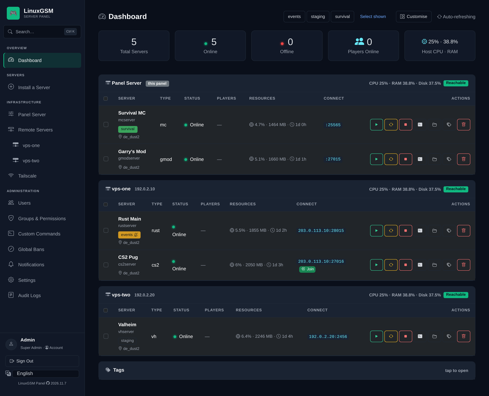
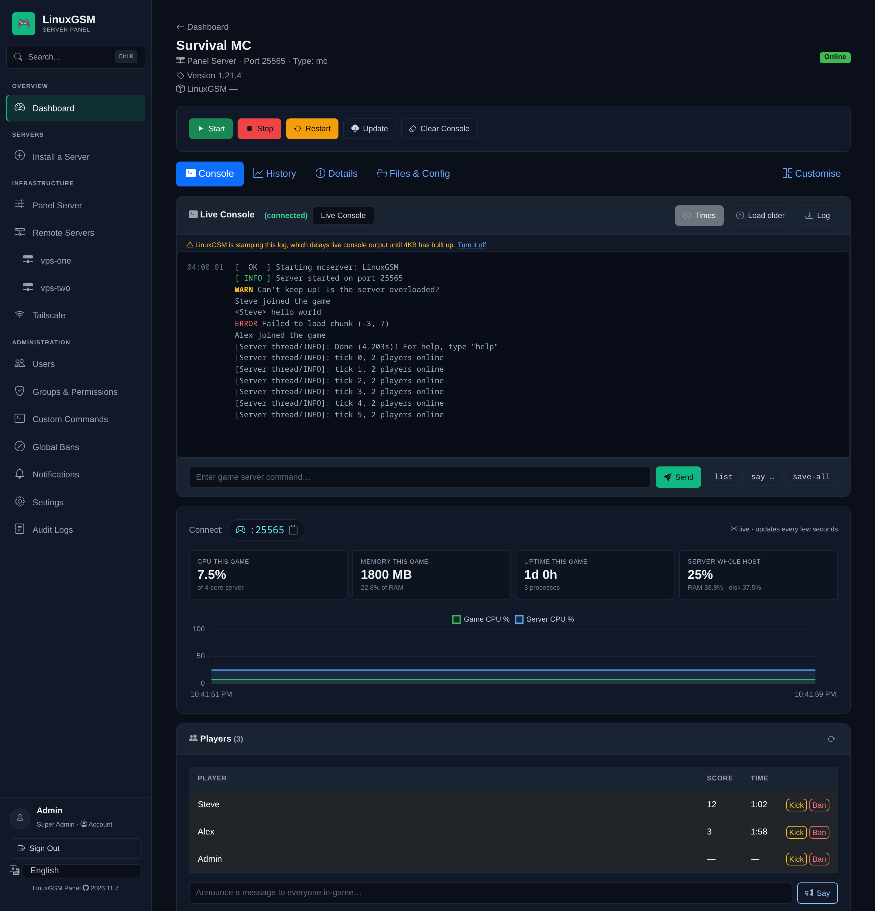

# LinuxGSM Panel 🎮

[](https://scorecard.dev/viewer/?uri=github.com/FMSMITH91/linuxgsm-panel) [](https://www.bestpractices.dev/projects/15363) [](https://app.codacy.com/gh/FMSMITH91/linuxgsm-panel/dashboard?utm_source=gh&utm_medium=referral&utm_content=&utm_campaign=Badge_grade)

[](https://github.com/FMSMITH91/linuxgsm-panel/actions/workflows/ci.yml) [](https://github.com/FMSMITH91/linuxgsm-panel/actions/workflows/codeql.yml) [](https://github.com/FMSMITH91/linuxgsm-panel/actions/workflows/security.yml) [](https://github.com/FMSMITH91/linuxgsm-panel/actions/workflows/security-code.yml) [](https://github.com/FMSMITH91/linuxgsm-panel/actions/workflows/codeql-alerts.yml) [](../LICENSE) [](https://www.python.org)

A self-hosted web panel for managing **[LinuxGSM](https://linuxgsm.com)** game servers across one or more Ubuntu machines, with role-based access for super admins, server admins, and moderators. It installs, runs, updates and backs up your game servers, and manages the hosts they run on, from one browser tab or a phone.

📓 [Changelog](CHANGELOG.md) · 🔒 [Security policy](../.github/SECURITY.md) · 🔐 [HTTPS setup](https.md)

> ## ⚠️ Disclaimer — please read first
>
> - **Not an official LinuxGSM product** — an independent third-party panel, not affiliated with, endorsed by, or connected to LinuxGSM or its authors. "LinuxGSM" and any related marks belong to their respective owners.
> - **Created and modified almost entirely by AI.** Read the code and test it before trusting it with real servers or credentials.
> - **Provided "as is", no warranty — use at your own risk.** See [Security and privacy](#security-and-privacy).

| **Dashboard** — every server across every host | **Live console & per-game stats** |
|---|---|
|  |  |

More screenshots: [features.md](features.md#screenshots).

## Key features

- One-click install of any LinuxGSM game (130+), a real-time console, live player counts, and start/stop/restart/update that can wait until a server is empty.
- Mods & addons, a LinuxGSM settings form, a file browser, per-server schedules, scheduled Rust wipes and Garry's Mod content mounting.
- Backups of the panel and of each game server, scheduled or one-click, with retention, download and restore.
- One host page for the panel and every remote: OS updates, UFW firewall with lock-out checks, fail2ban and auto-block, SSH lockdown, clean reboots that bring running servers back.
- Users and groups with per-action, per-server permissions; a web terminal; audit logging; a Databases manager for game servers' MariaDB/MySQL databases.
- Alerts to Telegram, Discord, ntfy and your own phone or browser, and a Telegram/Discord command bot.

The full list: [features.md](features.md).

## Install

Needs a host running **Ubuntu 22.04, 24.04 or 26.04 LTS** for the panel, and game-server machines it can reach over SSH (the panel host can manage itself).

```bash
curl -fsSL https://raw.githubusercontent.com/FMSMITH91/linuxgsm-panel/main/install.sh | bash
```

Then open the link the installer prints at the end; the setup wizard there creates your first super admin. To check what you install first, the release key's fingerprint is `SHA256:YhAumFmigcV9YJNrtPkaekEm1ed/NSL2Me3fxTjZ82w` (ED25519); [SECURITY.md](../.github/SECURITY.md#checking-a-first-install) shows how. What the installer does, its options, and uninstalling: [install.md](install.md).

## Update

In the panel: *Panel Server → Panel → Panel Updates → Update now*. From the shell, run the installer already on the host: `cd / && sudo bash /usr/local/lib/linuxgsm-panel/install.sh` (root install) or `bash ~/linuxgsm-panel/install.sh` (per-user). Only signed releases are installed, and a failed update rolls back by itself: [install.md](install.md#updating).

## Security and privacy

The panel never runs as root, serves HTTPS by default, hashes passwords with Argon2id, offers TOTP 2FA, and encrypts credentials at rest; updates are signed. No telemetry, no analytics, no third-party scripts. Details: [security-features.md](security-features.md), [SECURITY.md](../.github/SECURITY.md), [THREAT-MODEL.md](THREAT-MODEL.md) and [PRIVACY.md](PRIVACY.md).

## Documentation

- [install.md](install.md): requirements, the installer and its options, updating, uninstalling, removing a host.
- [features.md](features.md): every feature, host reboots and their API, phone and browser alerts, screenshots.
- [configuration.md](configuration.md): `config.json` settings, production deployment, the nginx block, Headscale.
- [https.md](https.md): the ways to serve the panel over HTTPS, and bans behind a proxy or tunnel.
- [addons.md](addons.md): admin tools (IW4MAdmin, B3) in locked-down containers beside a game server.
- [permissions.md](permissions.md): every permission, the panel owner, the Databases manager.
- [security-features.md](security-features.md): passwords, 2FA, sessions, encryption at rest, and recovering a locked-out panel.
- [PRIVACY.md](PRIVACY.md), [THREAT-MODEL.md](THREAT-MODEL.md), [NTFY-SELF-HOST.md](NTFY-SELF-HOST.md) and the [security policy](../.github/SECURITY.md).
- [development.md](development.md): running from a checkout, the test suites, CI, the code layout.

## Contributing

Issues and pull requests are welcome; report security issues privately via [SECURITY.md](../.github/SECURITY.md). How to run the suites first: [development.md](development.md#contributing).

## License

MIT
