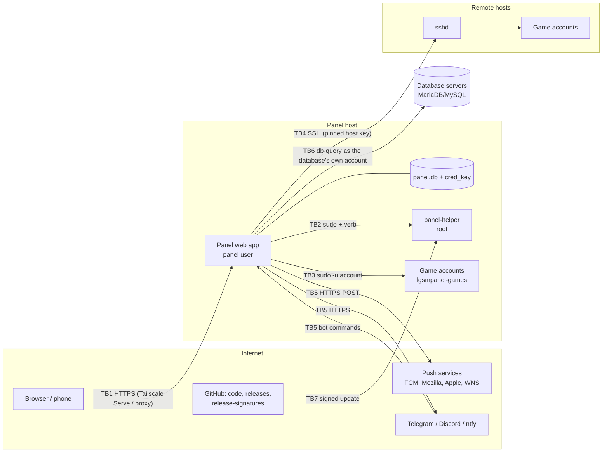

# Threat model

This is the panel's threat model, written to the OWASP Threat Modeling Cheat Sheet: its four
questions, a data-flow model with its trust boundaries, STRIDE against each boundary, a response for
every threat, and how the result is checked. It describes `main`; keep it in step with the code (the
"Keeping it current" section says when).

| Question | Where it is answered |
| --- | --- |
| What are we working on? | [System model](#system-model), [Assets](#assets) |
| What can go wrong? | [STRIDE per trust boundary](#stride-per-trust-boundary) |
| What are we going to do about it? | The mitigations in each table, and [Residual risks](#residual-risks) |
| Did we do a good enough job? | [Review and validation](#review-and-validation) |

Technique: STRIDE per trust boundary, chosen because the panel's risk sits where data crosses from
one owner to another (a browser to the panel, the panel to root, the panel to a game account). It
does not cover privacy threats as LINDDUN would, nor business-logic abuse beyond what the
permission model expresses; those are named under residual risks where they matter.

## System model

The panel is a Flask application (`panel/install/app.py`, routes in `panel/routes/`) that manages
LinuxGSM game servers on its own host and on remote hosts over SSH. It keeps its state in SQLite
(`data/panel.db`) and its secrets encrypted at rest (`data/cred_key`, `panel/core/cred_keyring.py`).

Trust boundaries:

| ID | Boundary | Who is on the far side |
| --- | --- | --- |
| TB1 | Browser to panel | anyone who can reach the port; signed-in users with a role |
| TB2 | Panel to root (the helper) | the panel's own account, which a web compromise would hold |
| TB3 | Panel to game accounts | game server processes, mods and plugins, players' data |
| TB4 | Panel to remote hosts | the remote's sshd and its game accounts |
| TB5 | Panel to push services and chat channels | third-party services; anyone in a bot's channel |
| TB6 | Panel to database servers | database contents written by players and plugins |
| TB7 | GitHub to an installed panel (updates) | anyone holding the GitHub account or a CI token |
| TB8 | CI runners (pull-request code) | anyone who opens a pull request |

## Assets

| Asset | Why it matters | Where it lives |
| --- | --- | --- |
| Root on the panel host | the helper runs as root; the wide grant is root outright | `/usr/local/lib/linuxgsm-panel/panel-helper`, `/etc/sudoers.d/linuxgsm-panel` |
| Accounts, sessions and 2FA seeds | a superadmin is root-equivalent on the panel host | `panel.db` (`panel/db/models.py`), session cookie |
| Stored secrets: SSH passwords and key paths for remotes, bot and channel tokens, database passwords, VAPID key | each opens another system | `panel.db` and `config.json`, encrypted with the key ring; an SSH key file itself stays on disk, protected by its file permissions |
| The key ring | decrypts every stored secret | `data/cred_key` (mode 0600) |
| Game servers and their files, worlds and backups | the service the panel exists for | game accounts' homes, local and remote |
| Databases of game servers | players' data | MariaDB/MySQL, local or on another machine over Tailscale |
| The release key and the update path | every panel installs what it verifies | the signer's machine; `release-signatures` branch; `panel/install/release-signers` |
| Audit log | accountability for every change | `panel.db` `audit_log` (`panel/security/auth.py` `log_action`) |

## STRIDE per trust boundary

Each row is one threat, the response (Mitigate, Eliminate, Transfer, Accept) and the controls with
the file that holds them.

### TB1: browser to panel

| STRIDE | Threat | Response and controls |
| --- | --- | --- |
| S | Password guessing, credential stuffing | Mitigate: Argon2id hashes, per-account throttle and lockout, a new password screened against the bundled common-password rules, a downloaded list of 100,000 breached passwords and (when the setting is on) Pwned Passwords, required 2FA for admins (`panel/security/account_guard.py`, `panel/security/auth.py`, `panel/core/common_passwords.py`, `panel/core/breached_passwords.py`). |
| I | A new password leaves the panel for the breach check | Mitigate: k-anonymity: only the first five hex characters of its SHA-1 go to `api.pwnedpasswords.com`, the answer is padded, the match is made locally; nothing else is sent. Only after the local checks pass; Settings switches it off; no answer within 3 s keeps the local result (`panel/core/breached_passwords.py`). |
| S | Session theft or fixation | Mitigate: `__Host-` cookie, Secure/HttpOnly/SameSite, rotation on sign-in, idle and absolute limits, session bound to its client address (IPv6 by /64) and User-Agent under "strong" protection, server-side revocation (`__Host-` prefix in `panel/security/auth.py`; `panel/security/session_cookie.py`, `panel/core/session_policy.py`). |
| T | Cross-site request forgery | Mitigate: CSRF token on every state-changing request (Flask-WTF `CSRFProtect`, `panel/install/app.py`), Fetch Metadata guard with the Origin/Referer check as its fallback (`panel/routes/account_security.py`), SameSite cookie. A page left open across a new session gets that session's token in the JSON refusal of an in-page request and resends it once (`_csrf_refused`, `panel/static/js/panel.js`); only same-origin script can set the header or read the reply. Behind a proxy that hides the panel's address, the target origin is configured (`site_domain`, `manage.py set-site-domain`) and the journal says so when a form was refused for it. |
| S | Traffic read or altered in transit | Mitigate: HTTPS through Tailscale Serve, a reverse proxy or the panel's own TLS (ECDSA P-256, SHA-256, 397 days, `panel/services/certs.py`), HSTS. An operator's CA-signed certificate in `data/ssl` is never replaced by a self-signed one; a weak key, SHA-1/MD5 signature, mismatched key or expiry is logged at start-up, and the expiry alert starts 30 days ahead. |
| T | Injection (SQL, shell, template, path) | Mitigate: SQLAlchemy bound parameters; validation before a value reaches a shell (`panel/core/validation.py`); no shell between the panel and root (TB2); Jinja autoescape; strict CSP (`panel/security/headers.py`). |
| R | A user denies a change | Mitigate: audit row for every change with actor and address (`log_action`); denials logged (`account_guard.py`). |
| I | Secrets shown to a role that should not see them | Mitigate: permission per route (`panel/security/auth.py`), server access per group, LinuxGSM `details` masked for roles without MANAGE_SERVERS, debug report scrubbing (`panel/ops/debug_report/privacy.py`). |
| D | Request floods, huge uploads | Mitigate: app-wide request cap, chunked uploads with size limits (`panel/routes/backup_upload.py`, `panel/routes/databases_files.py`), the panel's own ban list (`panel/security/banlist.py`) beside fail2ban. Transfer: volumetric floods to the network in front (Tailscale or a proxy). |
| E | A lower role reaches an admin action | Mitigate: deny by default, permission checks on every request, step-up re-authentication for root-equivalent actions (`account_guard.py`), the owner account no other admin can change (`panel/security/owner.py`). |

### TB2: panel to root (the helper)

| STRIDE | Threat | Response and controls |
| --- | --- | --- |
| S | Another local process poses as the panel | Mitigate: sudoers grants the helper to the panel's account only; the helper is root-owned outside the checkout. |
| T | The panel (if compromised) hands root a crafted command | Mitigate: verbs, not shell text: the helper re-validates every argument against its own table and execs a fixed argv (`tools/panel-helper`, mirrored by `panel/security/privileged.py`); destinations and log sources are names, not paths. |
| T | Root runs code from the panel-owned checkout | Eliminate: root stages its pieces from its own clone, at or above a source floor, and only signed commits (see SECURITY.md, "Root never runs or installs from the panel's checkout"). |
| R | Root actions without a trace | Mitigate: each root-equivalent action is audited by the route that starts it (`log_action`). |
| I | Secrets on a command line | Mitigate: secrets travel on stdin (`run_privileged(..., secrets=...)`), never argv. |
| D | A verb hangs the host | Mitigate: timeouts on every verb call; long jobs are detached with their own bounds. |
| E | Wide grant (`NOPASSWD: ALL`) when a root piece is missing | Accept, stated: the installer prints which grant it wrote; SECURITY.md tells how to get the narrow one or drop the local grant. |

### TB3: panel to game accounts

| STRIDE | Threat | Response and controls |
| --- | --- | --- |
| S | An account name that is really root or another user | Mitigate: `game_user_cmd` / `game_user_exec_cmd` refuse anything but a plain identifier, never `root`; Runas is `%lgsmpanel-games` only. |
| T | A game account that can escalate is enrolled, then driven by the panel | Mitigate: enrollment refuses accounts in root-equivalent groups or named by sudoers/doas/polkit; every write path calls `game_account_write_refusal` first (`panel/routes/_shared.py`). |
| T | Files the panel writes for a game account start code later (shell start-up files, `~/.ssh`) | Mitigate: the file tools refuse such targets (resolved host-side). |
| I | Game output (console, logs, player names) carries escapes or markup | Mitigate: terminal rendering strips control sequences (`panel/core/terminal.py`, fuzzed by `tests/fuzz/fuzz_console.py`); templates escape. |
| D | A game's output floods the panel | Mitigate: bounded reads and rings for console feeds. |
| E | A mod or plugin uses the panel to reach root | Mitigate: game accounts cannot write `/etc`, the helper or sudoers; the panel never runs game-authored text as a command. |

### TB4: panel to remote hosts

| STRIDE | Threat | Response and controls |
| --- | --- | --- |
| S | Man in the middle on the first or a later connection | Mitigate: host keys pinned on first use and enforced after (`panel/ops/ssh_manager/_core.py` `_PinPolicy`); an optional fingerprint on the Add Remote Server form and Edit makes the first connection verified too, refused before the credential is sent when it does not match (`panel/routes/remotes.py`). Accept: without a fingerprint the first connection is trust on first use. |
| T | Remote output crafted to mislead the panel's parsers | Mitigate: parsers degrade to empty on bad input and are fuzzed (`tests/fuzz/`: status replies, ufw, cron, configs, fail2ban). An empty read is never taken as a measurement. |
| I | Stored SSH credentials leak | Mitigate: passwords and key paths encrypted at rest with the AES-256-GCM key ring; never logged; backups hold them encrypted. A key file is not copied into the panel: it stays where the operator keeps it, under its file permissions. |
| E | Panel's own host reached through a "remote" entry | Mitigate: bootstrap, Tailscale install and join routes refuse the panel's own host. |

### TB5: push services and chat channels

| STRIDE | Threat | Response and controls |
| --- | --- | --- |
| S | A browser registers a push endpoint that points at an internal address (SSRF) | Mitigate: allow-list of push service hosts, https:443 only, request rebuilt from the parsed parts, every resolved address must be public (IPv4 carried in IPv6 unwrapped, IPv4-compatible refused), connect to the checked address, no redirects (`panel/services/webpush.py`; fuzzed by `tests/fuzz/fuzz_push.py`). |
| S | Someone takes over another account's subscription | Mitigate: a subscription moves only with proof of holding it (`panel/services/push_alerts.py`). |
| S | A stranger in a bot's channel sends commands | Mitigate: only the configured chat is answered; in it, commands that change anything run only for listed user ids, and the read-only /status, /servers, /hosts, /connect and /help are open (`panel/services/bots/commands.py` `OPEN_COMMANDS`, `command_refusal`; `panel/services/notifications.py` `parse_command_users`). |
| S | A stranger links their own Telegram chat to someone's account and gets that account's alerts | Mitigate: a link needs a one-time code the signed-in account asks for after a password re-check (128 random bits, SHA-256 at rest, 10 minutes, once, five per account per 10 minutes), claimed only from a private chat; the chat id is encrypted on the account, the link is audited and shown to the account as a change to its security (`panel/services/telegram_link.py`, `panel/routes/push_devices.py`). A linked chat only receives: commands still come from the chat on the Notifications page. |
| I | Alert text reveals more than a lock screen should | Mitigate: push text is the event and the server's name only; endpoints and keys never logged. |
| D | A slow push service stalls the panel | Mitigate: one background sender, bounded queue, timeouts. |

### TB6: database servers

| STRIDE | Threat | Response and controls |
| --- | --- | --- |
| T | A statement reaches another database | Mitigate: every statement runs as the database's own account, whose grant is that one database; identifiers come from the structure the panel read, values are bound parameters (`panel/ops/ssh_manager/db_data.py`). |
| T | An uploaded dump switches to another database | Mitigate: the upload scan refuses USE, CREATE/DROP/ALTER DATABASE, CONNECT and schema-qualified names of system or other panel databases, chained or not (`panel/ops/ssh_manager/db_upload_scan.py`; fuzzed by `tests/fuzz/fuzz_upload_scan.py`). The grant above still holds for what the scan does not read. |
| I | The audit log records a value typed into the SQL box | Mitigate: literals masked, comments skipped (`db_data.mask_literals`; fuzzed by `tests/fuzz/fuzz_db_data.py`). Each literal is read both with backslash escapes and as under NO_BACKSLASH_ESCAPES; where the two disagree about its end, the rest of the statement is not logged (`_mask_quoted`; tests/unit/part219.py). |
| I | A database on another machine is reachable from the internet | Mitigate: remote database servers only over Tailscale; the panel reports a server listening beyond loopback and the tailnet. |
| D | A runaway query | Mitigate: statement time limit with KILL QUERY, answer size cap (`tools/panel-helper` db-query). |

### TB7: GitHub to an installed panel

| STRIDE | Threat | Response and controls |
| --- | --- | --- |
| S | A commit merged by someone holding the GitHub account | Mitigate: panels install only commits signed with the release key, kept off GitHub, verified against the key the host already holds (`tools/sign-release.sh`, `install.sh`). |
| T | A dependency changed upstream | Mitigate: hashed lockfiles installed `--require-hashes --no-deps`; gamedig from a hash-locked npm lockfile; dependency review, pip-audit and osv-scanner in CI; a CycloneDX SBOM attached to each GitHub Release (`tools/sbom.py`). |
| T | The downloaded breached-password list is altered | Mitigate: fetched from a fixed SecLists commit and saved only when it hashes to the SHA-256 pinned in `install.sh`; the panel re-hashes it on every read and skips it on a mismatch (`panel/core/breached_passwords.py`). |
| R | Which code a release contains | Mitigate: release notes from the CHANGELOG, the signature and the SBOM on the release; the SBOM is reproducible from the tagged commit. |
| E | First install trusts whatever GitHub serves | Reduce, then accept: the release key's fingerprint is published in README and SECURITY.md, which shows how to check the commit's release signature before the first install; unchecked, it is trust on first use. |

### TB8: CI runners

| STRIDE | Threat | Response and controls |
| --- | --- | --- |
| T | Poisoned pipeline execution from a pull request | Mitigate: no `pull_request_target`; `workflow_run` jobs run main's copy and treat artifacts as untrusted; actions pinned by full SHA; required checks and signed commits on `main` (OWASP Top 10 CI/CD Security Risks, CICD-SEC-1 and CICD-SEC-4). |
| I | A secret reaches pull-request code | Mitigate: the only secrets live in environments only `main` can use; pull-request jobs hold the job token alone (CICD-SEC-6). |
| E | A job's token can do more than the job needs | Mitigate: every workflow starts with `permissions: {}` and each job grants only what it uses (CICD-SEC-5). |
| I | A compromised tool sends data out of a runner | Mitigate: Harden-Runner on every job but the deploy; the pull-request jobs that reach only known hosts run it in block mode with an allow-list; the rest audit (CICD-SEC-7, CICD-SEC-10). |

## Residual risks

| Risk | Response | Why, and who owns it |
| --- | --- | --- |
| A superadmin is root on the panel host | Accept | The panel manages the host, and every superadmin keeps its host-level powers there (firewall, SSH, OS updates, reboot, the panel's port, Tailscale, IP blocking, Ubuntu Pro) by design. The controls are step-up re-authentication before each of those changes and an audit row for each; the panel-host terminal and panel backup restore stay the panel owner's only. SECURITY.md says so and how to drop the local grant. Owner: whoever grants superadmin. |
| Wide sudo grant on an install missing a root piece | Accept, with a fix path | The installer prints it, and the panel host's page tells superadmins while it lasts (`system_ops.wide_sudo_grant`), with the command; re-running install.sh as root narrows it. |
| First SSH connection to a remote, and the first install, are trust on first use | Reduce, then accept | The Add Remote Server form (and Edit) takes the host key's SHA256 fingerprint (RFC 4251 section 4.1: a fingerprint checked out of band); left empty, the first key is trusted. The release key's fingerprint is published in README and SECURITY.md, with how to check a commit's signature before the first install. |
| The upload scan is a text scan, not an SQL parser | Accept | A keyword split over lines, a comment or vertical tab between keywords is not read; the database account's one-database grant refuses those statements. |
| The SQL box's audit line keeps numbers | Accept | String and hex literals are masked under either escape mode (a literal whose end depends on sql_mode masks the rest of the line), but decimal numbers stay in the audit line by design, so an id or amount typed into a statement is recorded. Owner: whoever grants EDIT_DATABASE_DATA. |
| Push services and chat platforms see alert metadata | Transfer | To the vendor, under its terms; the text is minimal. |
| An operator's own TLS certificate expires | Accept, with warning | With HSTS, browsers refuse an expired trusted certificate with no way past it, so the web page is unreachable until it is renewed; the panel and the host's shell keep working. The expiry alert warns from 30 days, and docs/https.md gives a certbot deploy hook that renews it in place. Owner: the operator who installed the certificate. |
| Harden-Runner audit-only jobs (unit suites, Lighthouse, ClusterFuzzLite, main-only jobs) | Accept for now | Their endpoints include test addresses, Chrome's own calls or Docker networking, or they cannot be checked by a pull request before main; their observed endpoints are recorded so they can move to block later. |
| ClusterFuzzLite's and Scorecard's runner images are named by tag inside their actions | Accept | Trust in Google's and OpenSSF's tags; noted in `.clusterfuzzlite/Dockerfile`. |

## Review and validation

- **Tests.** Nine suites run on every pull request (unit, smoke, rbac, template actions, input
  validation, URL map, manage, setup wizard, performance budget); every security check is proved by
  breaking the code it guards.
- **Fuzzing.** `tests/fuzz/` holds Atheris targets for the parsers of untrusted input, run 60 s each
  on pull requests that touch them, 600 s nightly, and by ClusterFuzzLite.
- **Scanners.** CodeQL, Bandit, Semgrep, zizmor, Gitleaks, pip-audit, osv-scanner, Dependency Review,
  SonarCloud and Codacy, with an open-alerts gate on main.
- **Penetration test.** An OWASP ZAP and WSTG test of a local panel (November 2026) found no critical
  or high issue; its medium and low findings were fixed in the next release.
- **This document** was checked against the code it points to when written; a reviewer should be
  able to find every control in the file named beside it.

## Keeping it current

Update this file when a change adds a trust boundary (a new kind of host, service or account), a new
way in (a route family, a bot, an upload), a new privileged verb family, or a new stored secret, and
when a residual risk's response changes. SECURITY.md summarises it for reporters and operators.
