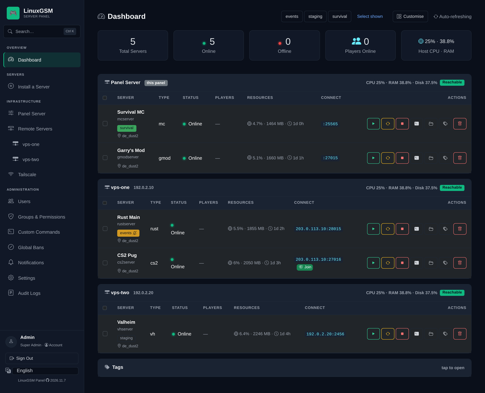
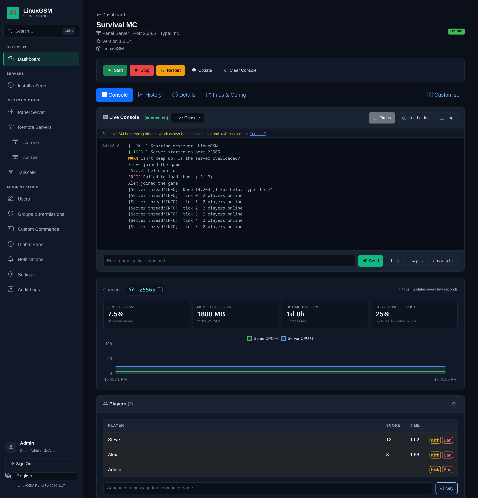
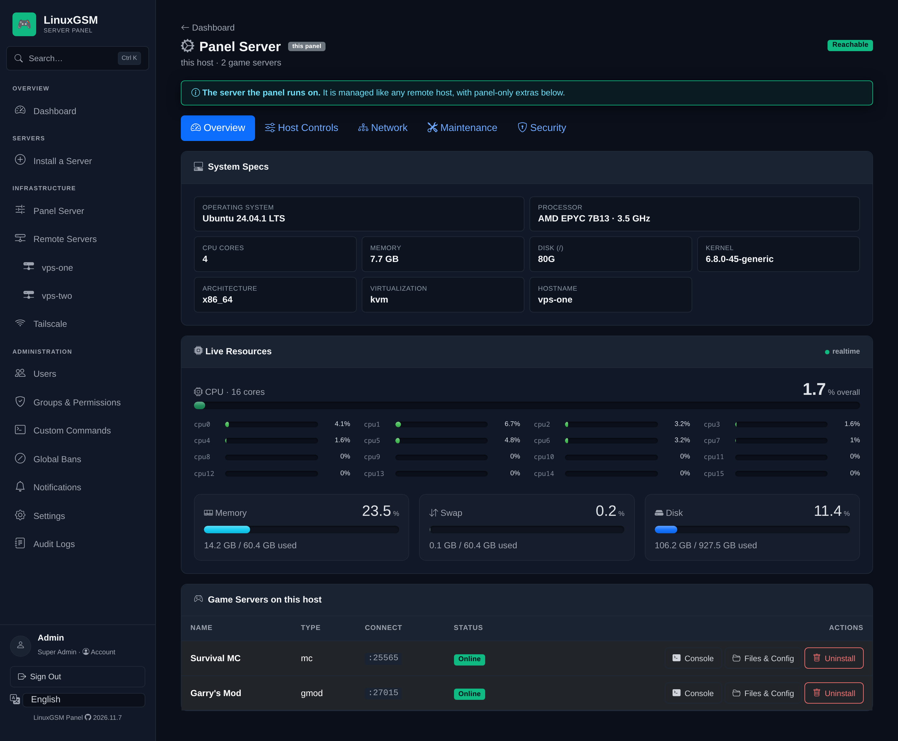
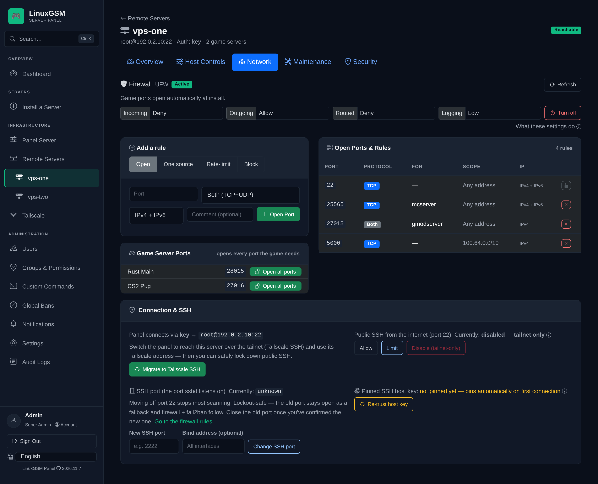
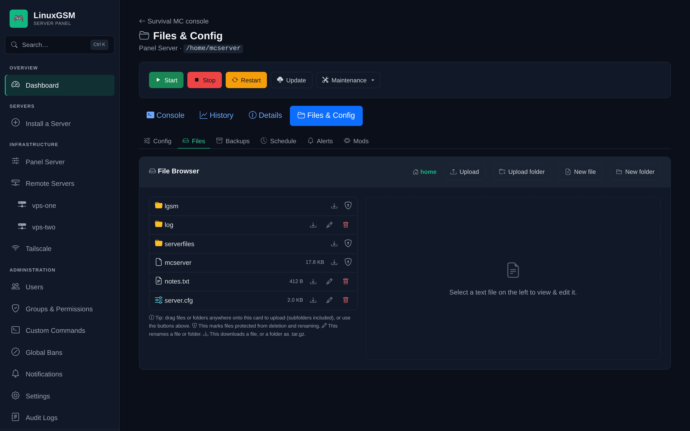
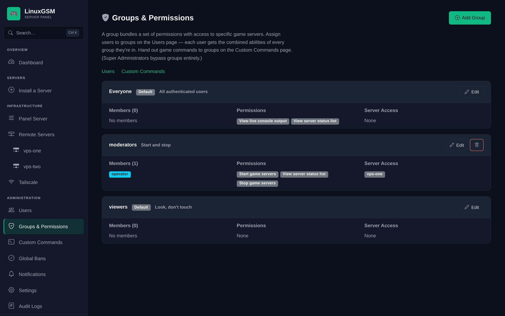
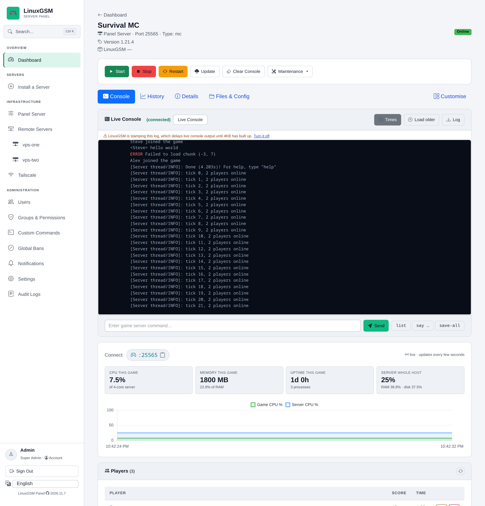
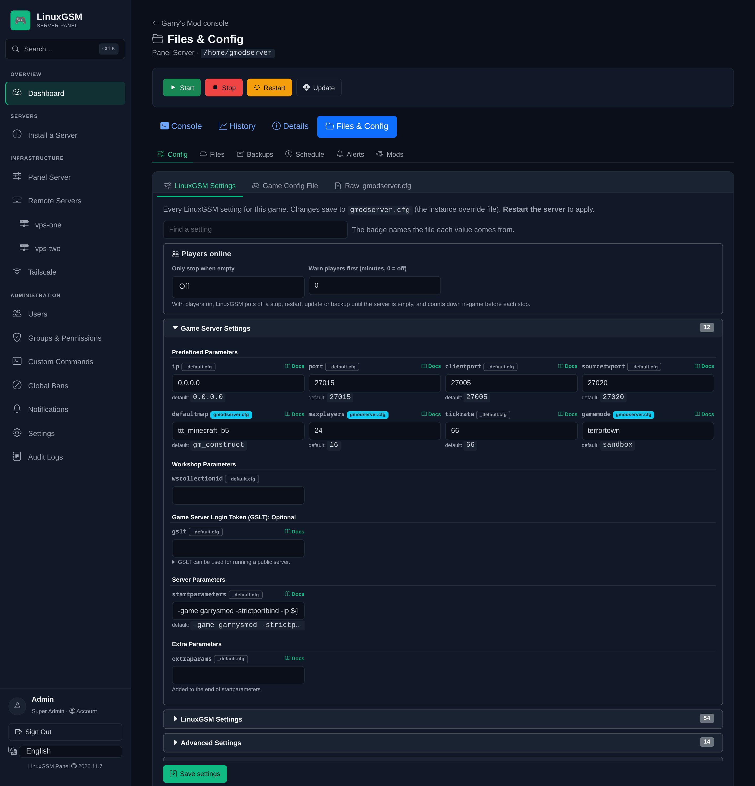
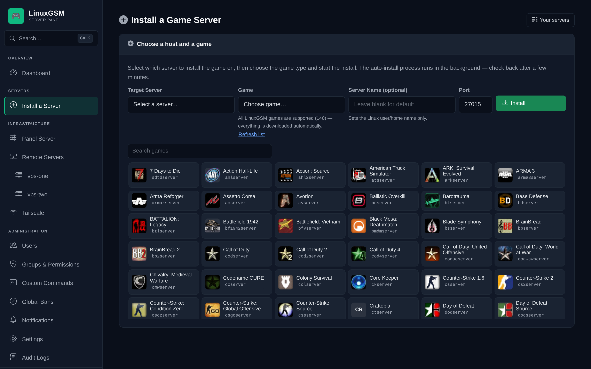
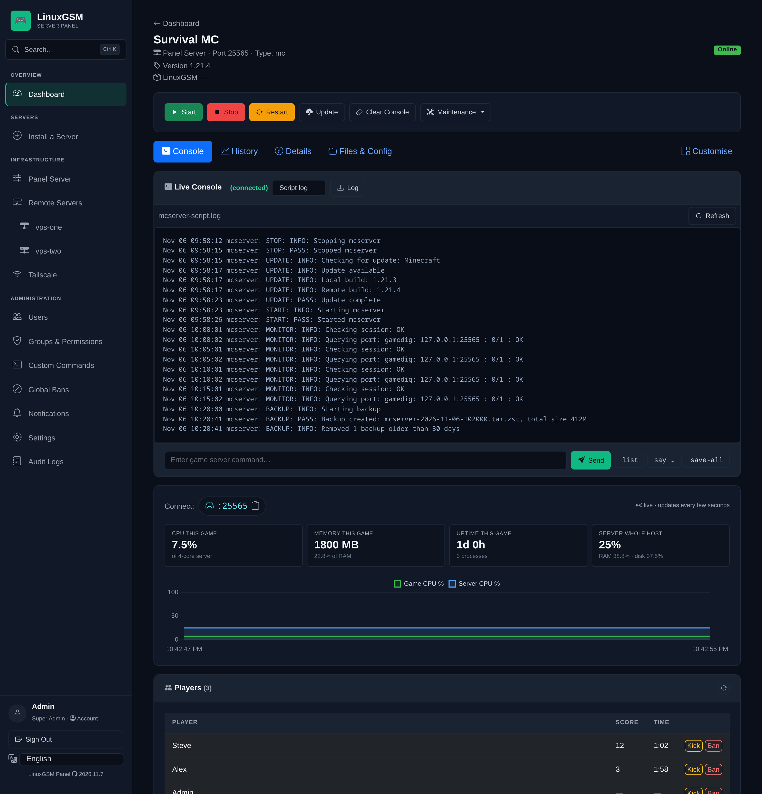

# Features

Back to the [README](README.md). Who may do what: [permissions.md](permissions.md). How the panel protects itself: [security-features.md](security-features.md).

## Game servers

- One-click install of any LinuxGSM game (Garry's Mod, Minecraft, CS2/CS:Source, TF2, ARMA 3, Rust, and 130+ more), with search and game icons.
- Real-time console with command history and quick commands, LinuxGSM's script log and the game's own log, per-game CPU/RAM/uptime, and live player counts.
- **History charts** on the server page and the host page: CPU, RAM, disk, network and players over the last 24 hours, 7 days, 30 days, 90 days, 6 months or year. The last 14 days keep a sample a minute; past that each hour is kept as its average, peak and low, for a year.
- Start/stop/restart/update/validate and more; restart, stop, backups and mod changes can wait until a server is empty.
- **Clean host reboots** — game servers are stopped cleanly first and the ones that were running come back. See [Rebooting a host](#rebooting-a-host).
- Mods & addons (SourceMod, MetaMod, Oxide, ULX…), FastDL, per-server schedules with autostart and restart-when-empty, and a file browser with upload, download and in-browser editing.
- A **settings form** for LinuxGSM's config, with LinuxGSM's own help for every setting.
- **Scheduled Rust wipes**, with a backup taken first.
- **Garry's Mod content mounting** — one shared copy of CS:Source and other Source games' content per host, mounted read-only into each GMod server.
- Per-server LinuxGSM alerts (Discord, Telegram, email, Pushover, Slack, Gotify, ntfy…).
- **Add-ons in containers**: admin tools beside a game server, each in a rootless Podman container as the server's own account. See [addons.md](addons.md).

## Backups

- One-click and scheduled backups of the panel (database, settings, keys) and of each game server, with retention, download and restore. Busy servers queue, and a backup that cannot fit on disk does not start.

## Access, security & hosts

- Users and groups with per-action permissions and per-server access, enforced server-side on every route. New accounts and invites start with the default **Everyone** group ticked (view servers and consoles); a group can start from the **Moderator** or **Admin** quick role, and Super Admin is a flag on the account (see [Permissions](permissions.md)).
- One host page for the panel and every remote: specs, live resources, OS updates, UFW firewall with lock-out checks, power controls, Ubuntu Pro, SSH lockdown, and lock-out-safe port changes.
- **Brute-force defense** — fail2ban logs and top offenders, one-click UFW blocking, and an optional rolling **auto-block**. A whitelist is never banned or blocked, and your Tailscale peers are never banned from the panel or auto-blocked. Bans still keep a visitor out of the panel behind a Cloudflare Tunnel or Funnel ([how](https.md#bans-and-blocks-behind-a-proxy-or-tunnel)).
- **Admin alerts** to Telegram, Discord and/or [ntfy](https://ntfy.sh) for 24 events — server down, host unreachable, disk low, high CPU/RAM load, brute-force, backup failed, update available, cert expiring, and more.
  By default an alert names no person and no address (sign-in IPs, usernames, banned IPs stay in the Audit log); a Notifications switch adds them. For alerts that never touch a public server or Google, [run your own ntfy server](NTFY-SELF-HOST.md).
- **Chat command bot** (Telegram *or* Discord): `/status`, `/servers`, `/players <name>`, `/start` / `/stop` / `/restart <name>`, `/update` and more. Opt-in and limited to the configured chat; in it, anyone can use `/status`, `/servers`, `/hosts`, `/connect` and `/help`, and every command that changes something runs only for the user IDs listed under Notifications → Telegram/Discord → *Users who may run commands*.
- Tailscale integration, multiple SSH remotes with host-key pinning, a web terminal, diagnostics, and audit logging.
- **Schedules** (Administration → Settings → Schedules): every job the panel runs by itself, with what it does, how often, and when it last ran and runs next. The daily panel backup's time of day, how often the panel checks for its own updates, and the daily OS-update check (its time, or off) can be changed there; times are shown in your own time zone.
- **Root's crontab** (the panel owner only, off by default): add, change and delete root's cron jobs on any host, with `/etc/cron.d` shown read-only and the panel's own files marked. The owner turns it on under Settings → Schedules; each change asks for the password (and 2FA code) and is audited with the old and new line. On the panel host it also has to be opened at install with `PANEL_ROOT_CRON=1`. A job runs as root, so anything it runs can change everything on that host.

**Also:** branding and session settings in-app, HTTPS by default, TOTP 2FA with backup codes, English/Spanish/French, light and dark themes, installable on a phone's home screen, and a **What's new** card after each update.

## Rebooting a host

Every reboot the panel makes goes the same way:

1. **Who is on.** With players on (or a count that can't be read), you choose **Wait: reboot when everyone has left** or **Reboot now**. Work a reboot would cut off (an install, a backup, an upgrade) refuses "now".
2. **Stop cleanly.** On a forced reboot players are warned in-game (60, 30 and 10 seconds) where the game can show a message, then each server gets LinuxGSM's graceful `stop`.
3. **Reboot and bring back what was running.** Servers with Autostart come back through LinuxGSM's monitor about 5 minutes after boot; the panel starts running servers without Autostart (a setting turns this off). Stopped servers stay stopped.
4. **One summary** in notifications says what came back and what did not.

A pending wait shows on the host's Power card with a **Cancel** button and gives up after 24 hours by default (`reboot_wait_max_hours`; 0 waits as long as it takes). Reboots made outside the panel are not changed.

The API takes a session cookie or an `Authorization: Bearer <token>` (Account → API access), with the same permissions as the page:

| Request | Does |
|---------|------|
| `POST /api/remote/<id>/reboot` `{"mode": "now" \| "when_empty"}` | Reboot now (202) or arm the wait (200). With no `mode` and players on: **409** `{"error": "players_online", ...}` |
| `POST /api/remote/<id>/reboot-cancel` | Cancel the wait, or a reboot not yet sent |
| `GET /api/remote/<id>/players` | Who is on |
| `GET /api/remote/<id>/reboot-plan` | What a reboot is doing (`?preview=1`: what it would do) |
| `GET /api/remote/<id>/reboot-required` | Whether a reboot is needed |
| `POST /api/server-management/reboot` `{"delay": 0-300, "mode": ...}` | The panel's own host (superadmin) |

## Alerts on your phone or browser

Each user can have the panel's alerts sent to their own browsers and phones as notifications (Web Push), and to their own Telegram chat. They arrive when the panel tab is closed and **after you sign out**, so a change to your account (a password change, two-factor turned off, a new API token) still reaches you. The panel never sends e-mail.

- **Turn on:** Account → **Alerts on this device** → **Turn on alerts**, then allow notifications when the browser asks. You confirm your password first if you have not signed in in the last few minutes. Up to 10 devices per account.
- **HTTPS is required.** Browsers only allow push on a secure page: the panel's HTTPS address (or Tailscale Serve), not plain `http://`. On iPhone and iPad, add the panel to the Home Screen and turn alerts on from there.
- **Which alerts:** you choose (Account → Which alerts). By default: a server goes offline unexpectedly, a host becomes unreachable, attacks on admin sign-ins, sign-ins paused for an account, a burst of login bans, another administrator's password, 2FA or token changing, and changes to your own account. You only get alerts about servers and hosts you can access; panel-wide ones (backups, updates, sign-ins, bans) go to super admins only. This is checked when each alert is sent.
- **What a lock screen shows:** the alert's title and the server's or host's name. Never an IP address, a player, a password or file contents. Tapping it opens the right page (you sign in first if you are signed out). The content is encrypted end to end between the panel and your browser; the push service only carries it.
- **Telegram:** Account → **Link my Telegram** (shown when the panel's Telegram bot is set up on the Notifications page), then **Open Telegram and press Start**. That chat gets the same alerts, with the same short text, as your browsers; it cannot send the bot commands. Linking asks for your password if you have not signed in recently, and the link code works once, for 10 minutes. **Unlink Telegram** stops it.
- **Stop them:** **Turn off on this device**, **Remove** a device from Account → Your devices and which alerts, or tick **Stop alerts on this device** when you sign out. Deactivating or deleting an account removes its devices.

Push goes through your browser's own push service (Google for Chrome and most Android browsers, Mozilla for Firefox, Apple for Safari, Microsoft for Edge on Windows); the panel sends only to those services, at public addresses.

## Screenshots

> Taken from a demo panel with sample data: IPs and hostnames are documentation placeholders (`192.0.2.x`, `203.0.113.10`).

| | |
|---|---|
| **Dashboard** — every server across every host | **Live console & per-game stats** |
|  |  |
| **Host manager** — panel host and every remote | **Firewall** — UFW rules, one-click game ports |
|  |  |
| **Files & config** | **Granular permissions** |
|  |  |
| **Light theme** | **Settings form** — LinuxGSM's own help for every setting |
|  |  |
| **Install a server** — every LinuxGSM game, with search | **LinuxGSM's script log** beside the live console |
|  |  |
